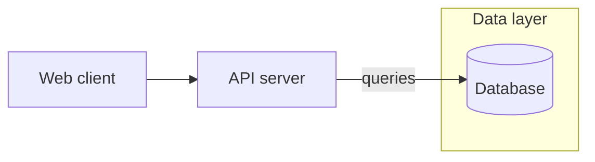
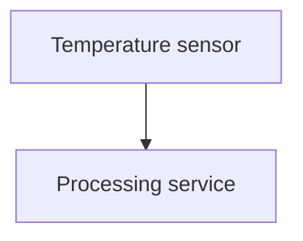

# Open Eraser

Open Eraser turns a supported subset of Mermaid flowcharts into polished,
architecture-focused SVG diagrams.

- Deterministic: the same input produces the same output.
- Offline: rendering makes no network requests.
- Local: no account, API key, browser service, or AI model is required.
- Portable: render to SVG or build a self-contained HTML artifact.

> **Project status:** early `0.x`. Flowcharts are supported; Open Eraser is not
> a drop-in renderer for every Mermaid diagram type or syntax feature.

## Install

Open Eraser requires Node.js 22 or newer.

```bash
npm install open-eraser
# or
pnpm add open-eraser
```

## Render an SVG

```js
import { render, themes } from 'open-eraser';

const source = `flowchart LR
  Client[Client] --> API[API gateway]
  API --> Database[(Database)]`;

const svg = await render(source, { theme: themes.dark });
```

You can also parse first and work with the diagram representation:

```js
import { parse, render } from 'open-eraser';

const diagram = parse('flowchart LR\n  A[Client] --> B[API]');
const svg = await render(diagram);
```

## Supported Mermaid subset

Open Eraser currently supports:

- `graph` and `flowchart` headers
- Directions: `TB`, `TD`, `BT`, `LR`, and `RL`
- Rectangle, rounded, cylinder, and circle nodes
- Chained edges and `A & B` node lists
- Solid, thick, dashed, and arrowless edge forms
- Edge labels using pipe or inline Mermaid forms
- Nested `subgraph` blocks
- Hex `fill` colors from `style` statements
- Open Eraser icon directives

Example:



The parser deliberately ignores Mermaid statements that do not affect the
current renderer, including `classDef`, `class`, `click`, `linkStyle`, and
accessibility metadata. Unsupported syntax fails with a line-numbered
`ParseError` rather than silently falling back to Mermaid.js.

Sequence diagrams, class diagrams, state diagrams, ER diagrams, Gantt charts,
and other Mermaid diagram types are not currently supported.

## Icons

Open Eraser can infer icons from node labels or accept explicit directives:



A manual mapping can be supplied through the API:

```js
const svg = await render(source, {
  icons: { overrides: { Service: 'cloud' } },
  onIconMiss(node) {
    console.log('No icon matched', node.id);
  },
});
```

The complete generated vocabulary ships with the package. In Node.js, locate
it with:

```js
const vocabularyUrl = import.meta.resolve(
  'open-eraser/icon-vocabulary.md',
);
```

## Offline HTML artifact

The package includes an HTML template containing the browser renderer, styles,
pan/zoom controls, tabs, and SVG download. It has no external runtime assets.

Resolve the template and inject diagram data:

```js
import { readFile, writeFile } from 'node:fs/promises';
import { fileURLToPath } from 'node:url';

const templateUrl = import.meta.resolve(
  'open-eraser/artifact-template.html',
);
const template = await readFile(fileURLToPath(templateUrl), 'utf8');

const data = JSON.stringify({
  title: 'System architecture',
  diagrams: [{ name: 'Overview', mermaid: source }],
}).replace(/<\//g, '<\\/');

// Use a replacement function so `$` sequences in diagram text stay literal.
const html = template.replace('__OPEN_ERASER_DATA__', () => data);
await writeFile('architecture.html', html);
```

The resulting file opens directly through `file://`.

## API

```ts
render(input: string | DiagramAST, options?: RenderOptions): Promise<string>
parse(source: string, options?: ParseOptions): DiagramAST
```

`RenderOptions` supports:

- `theme` — a `ThemeConfig`; defaults to `themes.dark`
- `icons.overrides` — icon names keyed by node ID
- `onIconMiss` — reports nodes that did not match the icon vocabulary
- `limits` — override the size limits below

### Size limits

Layout time grows quickly with diagram size, so oversized input is rejected
before layout with a `ParseError` (for Mermaid source) or `RangeError` (for a
custom `DiagramAST`).

| Limit | Default |
|---|---|
| `maxSourceLength` | 200,000 characters |
| `maxNodes` | 400 |
| `maxEdges` | 1,000 (after `A & B --> C & D` expansion) |
| `maxGroups` | 100 subgraphs |
| `maxDepth` | 20 nested subgraphs |

Raise them per call if you need to:

```js
const svg = await render(source, { limits: { maxNodes: 800 } });
```

The defaults are exported as `defaultLimits`.

The root package also exports the diagram and theme types, `iconManifest`, and
`layoutDiagram`. A bundler-oriented entry is available at
`open-eraser/browser`.

## How rendering works

```text
Mermaid source
    ↓ parse()
DiagramAST
    ↓ layoutDiagram()
ELK layout and cross-group routing
    ↓ renderSvg()
SVG string
```

Groups are laid out independently, then placed in a root layout. Cross-group
edges use deterministic curved routes around the resulting group geometry.

## Security

Open Eraser treats every input as data. It never executes JavaScript from
Mermaid source.

What the renderer enforces:

- **Text is escaped.** Node, edge and subgraph labels are XML-escaped. Icon
  names must match the built-in vocabulary. Colors must be hex values.
- **Custom objects are checked.** A `DiagramAST` passed to `render()` is
  validated for shape, allowed values and size. String fields in a custom
  `ThemeConfig` are attribute-escaped, and its numbers must be finite.
- **Size is limited.** See [Size limits](#size-limits).
- **The HTML artifact is locked down.** Its content security policy blocks all
  network access and allows only the artifact's own scripts, by hash. Inline
  event handlers cannot run. Diagram data is embedded as inert JSON with `</`
  escaped.

What it does not do:

- It is not a sandbox for arbitrary SVG or JavaScript.
- A hostile custom theme can make colors render wrong. It cannot inject markup.
- `layoutDiagram()` is a lower-level API and does not validate its input.
  Prefer `render()` for untrusted data.

Report suspected vulnerabilities using [`SECURITY.md`](SECURITY.md).

## Development

```bash
pnpm install
pnpm test
pnpm typecheck
pnpm build
pnpm check:package
```

Useful commands:

| Command | Purpose |
|---|---|
| `pnpm test` | Run the test suite |
| `pnpm typecheck` | Type-check source and tests |
| `pnpm build` | Build the library, artifact template, and icon vocabulary |
| `pnpm check:package` | Pack, install, and exercise the package externally |
| `pnpm pipeline` | Render the detailed fixture to local QA output |
| `pnpm demo-artifact` | Build an example offline artifact |
| `pnpm icon-sheet` | Generate the icon contact sheet |

Generated QA output is ignored by Git.

See [`CONTRIBUTING.md`](CONTRIBUTING.md) before submitting a change.

## License

Open Eraser is available under the [MIT License](LICENSE). It uses and adapts
third-party work under compatible licenses; see
[`THIRD_PARTY_NOTICES.md`](THIRD_PARTY_NOTICES.md).
